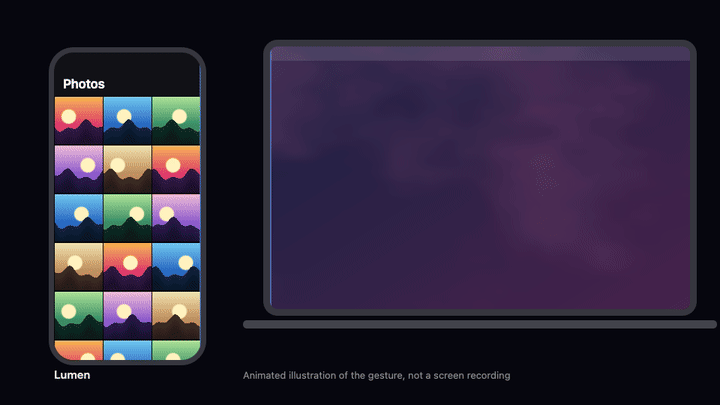

# Lumen

Lumen makes an iPhone and a Mac feel like one surface. Drag a photo off the edge of the iPhone and it enters through the edge of the Mac at the same physical size, wrapped in light that takes its colors from the photo.



_Animated illustration of the gesture, not a screen recording._

> **Status:** early development. Nothing is ready to install yet.

## How it works

- **One gesture.** Lift a photo in Lumen's gallery, drag it toward the Mac, and let go. It lands on a floating shelf, ready to drop into any app or folder, with the original file intact.
- **Knows where your iPhone is.** Stereo ultrasound, device motion, drag history and Bluetooth proximity are fused into an estimate of which side of the Mac the iPhone is on. There is no setup screen.
- **Synchronized light.** A shared clock and a real-time UDP channel keep the effects on both screens in step.
- **Local only.** No server, no account, no cloud. Everything travels encrypted over your local network, and microphone audio is never stored or sent.

## Stack

| Area     | Technology                                                        |
| -------- | ----------------------------------------------------------------- |
| iPhone   | React Native CLI (New Architecture), TypeScript, Reanimated, Skia |
| Mac      | Swift 6, SwiftUI + AppKit, Metal, menu bar app                    |
| Shared   | `LumenKit` Swift Package: DSP, protocol, transport, cryptography  |
| Protocol | Protocol Buffers, generated for Swift and TypeScript              |

Requires iOS 18 and macOS 15 or later.

## Development

Requires Node 24, pnpm, Xcode, CocoaPods, `protoc`, SwiftLint and SwiftFormat.

```bash
pnpm install
pnpm check
```

To run the apps:

- **iPhone:** run `pnpm --filter @lumen/ios pods`, open `apps/ios/ios/Lumen.xcworkspace`, select your team under Signing & Capabilities and run. Start Metro with `pnpm --filter @lumen/ios start`.
- **Mac:** run `pnpm mac`. The app appears in the menu bar, not the Dock.

## License

[MIT](LICENSE)
